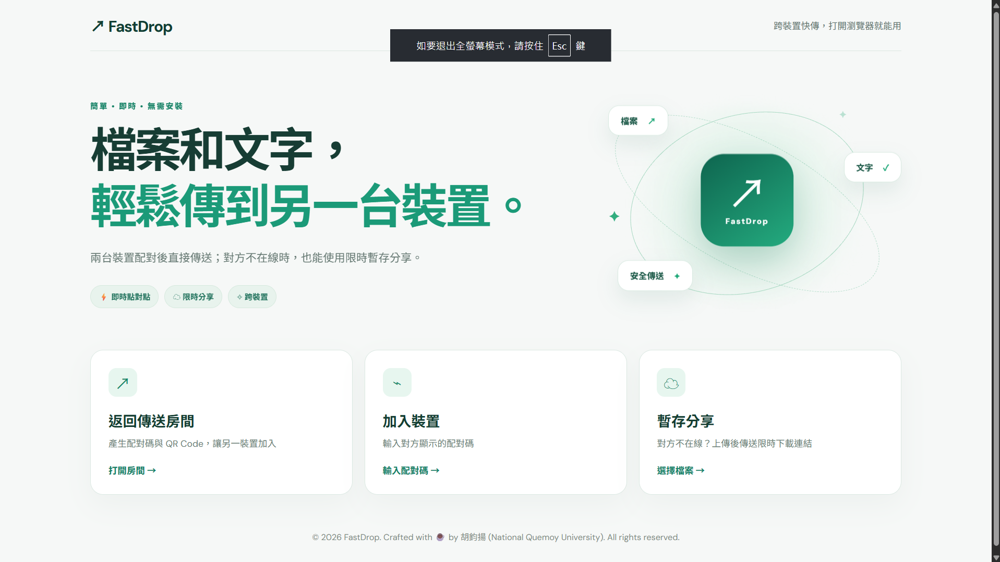
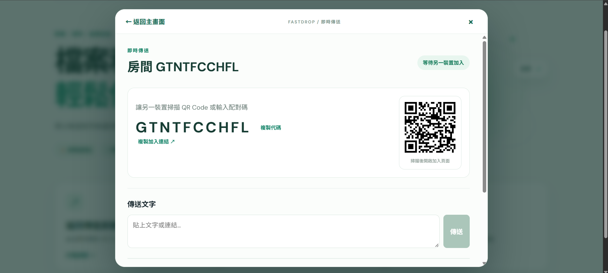
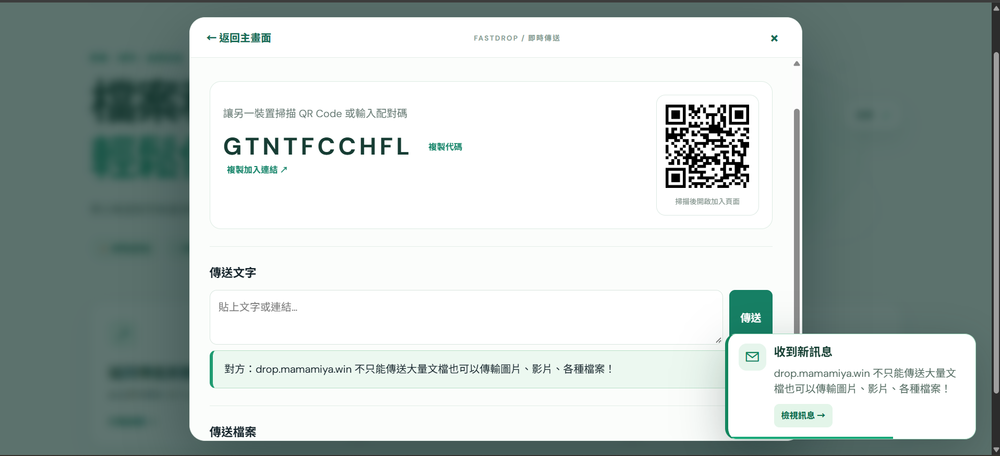
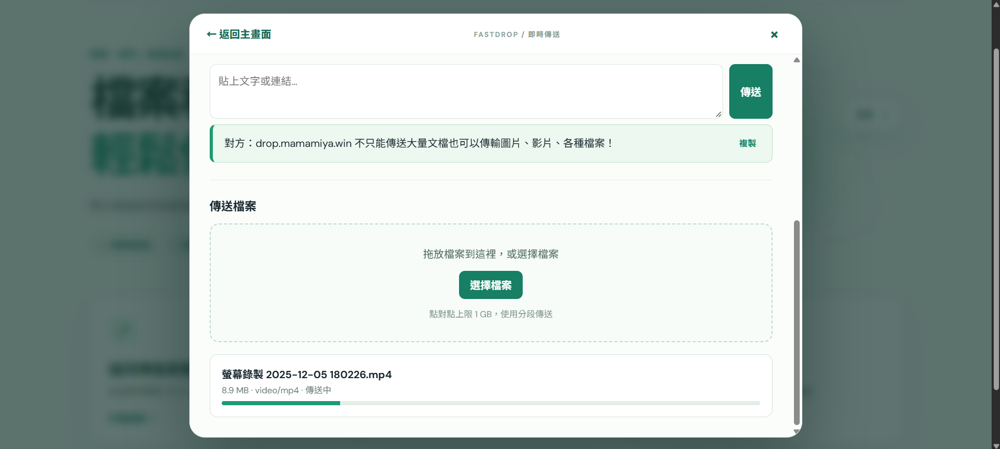
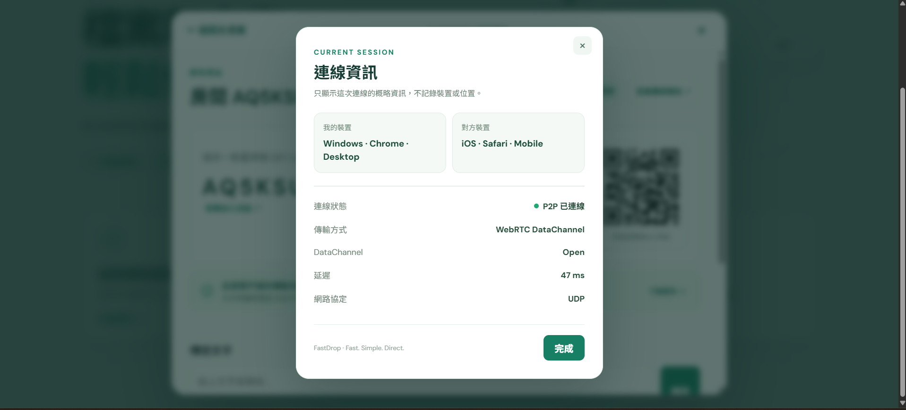
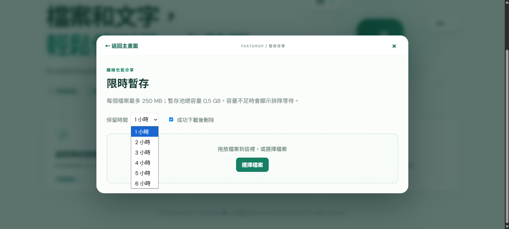

<div align="center">

# ⚡ FastDrop

### Fast. Simple. Direct.

**免安裝、免帳號，打開瀏覽器就能跨裝置傳送文字與檔案。**

### 🌐 [立即使用 FastDrop → drop.mamamiya.win](https://drop.mamamiya.win)

> `mamamiya.win` 為本專案作者 **胡鈞揚** 個人持有與管理之網域。  
> `drop.mamamiya.win` 為 FastDrop 的官方線上部署入口，並非第三方服務或外部網站。

</div>

---

## 👋 FastDrop 是什麼？

FastDrop 是一個以 **WebRTC + Cloudflare** 打造的跨裝置即時傳輸工具。

當兩台裝置同時在線時，FastDrop 會優先建立 **WebRTC Peer-to-Peer** 連線，讓文字與檔案直接在裝置之間傳送。

如果對方目前不在線，也可以改用 **Cloudflare R2 限時暫存分享**，產生短期下載連結，稍後再由另一台裝置取得檔案。

不需要安裝 App、不需要註冊帳號，也不限定特定作業系統。

支援：

- Windows
- macOS
- iPhone / iPad
- Android
- 其他支援現代瀏覽器的裝置

### 🚀 最快的使用方式

直接開啟：

**[https://drop.mamamiya.win](https://drop.mamamiya.win)**

即可立即使用 FastDrop。



---

## ✨ 核心功能

### ⚡ 即時點對點傳送

建立臨時房間後，FastDrop 會產生：

- 10 位配對碼
- QR Code
- 快速加入連結

另一台裝置可以直接：

```text
建立房間
    ↓
取得配對碼 / QR Code
    ↓
另一台裝置加入
    ↓
建立 WebRTC P2P 連線
    ↓
開始傳送 🚀
```

連線完成後，可以直接傳送：

- 📝 文字與網址
- 📄 文件
- 🖼️ 圖片
- 🎬 影片
- 📦 其他一般檔案

FastDrop 的 P2P 模式單一檔案目前最高支援 **1 GB**。

傳輸時使用分段讀取與緩衝控制，避免一次將整個大型檔案載入記憶體。

---

## 🔗 QR Code 快速配對

建立房間後，FastDrop 會顯示 QR Code。

手機只需要掃描即可進入對應房間，不需要：

- 輸入 IP
- 安裝額外軟體
- 尋找區域網路裝置
- 建立使用者帳號

如果不方便掃描，也可以直接輸入房間的 10 位配對碼。



---

## 📝 即時文字與剪貼簿傳送

FastDrop 不只能傳檔案，也能直接在不同裝置之間傳送文字。

例如：

```text
Windows
   ↓
複製網址 / 程式碼 / 一段文字
   ↓
FastDrop
   ↓
iPhone
```

收到文字後可以直接複製。

因此一些原本常見的操作：

> 「把網址傳到 LINE 給自己，再用手機打開」

可以直接變成：

> 「FastDrop 傳過去。」

收到新訊息時，介面也會顯示即時通知與倒數提示。



---

## 📁 P2P 檔案傳送

FastDrop 支援：

- 拖曳檔案
- 手動選擇檔案
- 即時傳輸進度
- 傳輸成功 / 失敗狀態
- 收到後直接儲存

傳輸介面會顯示：

- 檔案名稱
- 檔案大小
- 檔案類型
- 傳輸進度
- 傳送結果

### P2P 傳輸規格

| 項目 | 規格 |
|---|---:|
| 單一檔案上限 | 1 GB |
| 傳輸方式 | WebRTC DataChannel |
| 傳輸策略 | Chunked Transfer |
| 傳輸緩衝 | Backpressure Control |
| 是否經過 R2 | 否 |

正常 P2P 模式下，實際檔案內容會直接在兩台裝置之間傳送。

Cloudflare 主要負責連線協調與必要的後端邏輯，而不是替每個 P2P 檔案做中轉。



---

## 🟢 即時連線資訊

兩端成功建立 WebRTC 連線後，FastDrop 可以顯示目前連線的概略資訊，讓使用者知道正在與什麼裝置建立 P2P 傳輸。

### 裝置資訊

雙方會透過既有的 WebRTC DataChannel 暫時交換概略裝置資訊，例如：

- 作業系統：Windows、macOS、iOS、Android、Linux
- 瀏覽器：Chrome、Edge、Safari、Firefox
- 裝置類型：Desktop、Mobile、Tablet

例如：

```text
我的裝置
Windows · Chrome · Desktop

對方裝置
iOS · Safari · Mobile
```

這些資訊只用於**目前這次連線的畫面顯示**，不會建立裝置歷史紀錄，也不會寫入 D1 作為追蹤資料。

FastDrop 不會為此功能顯示或蒐集：

- 完整 IP 位址
- GPS 位置
- 精準地理位置
- 精準手機型號
- 不必要的裝置指紋資訊

### WebRTC 連線狀態

FastDrop 亦會使用 WebRTC 提供的連線統計資訊顯示：

| 項目 | 範例 |
|---|---|
| 連線狀態 | P2P 已連線 |
| 傳輸方式 | WebRTC DataChannel |
| DataChannel | Open |
| 延遲 | 47 ms |
| 網路協定 | UDP |

能取得相關資料時，也可在檔案傳輸期間顯示傳輸速度。



### 🛡️ P2P 隱私提示

FastDrop 的即時房間會標示：

> **此房間不儲存傳輸內容 · WebRTC P2P**

這裡所指的是**文字與檔案內容不會先存入 Cloudflare R2**。

Cloudflare Worker 與後端仍會協助：

- 建立臨時房間
- 裝置配對
- 交換 WebRTC signaling 資訊

當 WebRTC 連線建立完成後，實際的文字與檔案內容會優先直接在兩台裝置之間傳送。

```text
你的裝置  ═════════════▶  對方裝置
             WebRTC
```

只有使用者主動選擇 **「限時暫存分享」** 時，檔案才會進入 Cloudflare R2 暫存流程。

---

# ☁️ 限時暫存分享

如果接收方目前不在線，可以改用 **Cloudflare R2 暫存模式**。

使用者可以選擇保存時間：

```text
1 小時
2 小時
3 小時
...
最長 6 小時
```

也可以啟用：

> 🔥 **下載成功後立即刪除**

上傳完成後，FastDrop 會產生臨時下載連結。

這時傳送端可以直接離線，接收者只要在有效期限內開啟連結即可取得檔案。

### 暫存模式限制

| 項目 | 規格 |
|---|---:|
| 單一檔案上限 | 250 MB |
| FastDrop 暫存安全池 | 0.5 GB |
| 保存期限 | 1～6 小時 |
| 上傳方式 | 8 MiB 分段 |
| 過期處理 | 自動失效與清理 |
| 下載後刪除 | ✅ 支援 |

> **0.5 GB 是 FastDrop 自行設定的「同時占用及預留容量安全限制」，並不代表 Cloudflare R2 帳號本身只有 0.5 GB 額度。**



---

# 🧠 容量預留與排隊機制

FastDrop 不會等到檔案已經傳上 R2 後，才發現空間不足。

在暫存上傳開始前，系統會先透過 D1 執行容量預留。

```text
準備上傳
    ↓
檢查檔案大小
    ↓
向 D1 預留容量
    ↓
┌───────────────┐
│   容量足夠？   │
└───────┬───────┘
        │
   ┌────┴────┐
  YES        NO
   ↓          ↓
開始上傳    進入 Queue
   ↓
Cloudflare R2
```

容量不足時，檔案會先進入等待佇列，而不是直接開始上傳。

這能避免多名使用者同時操作時，同時判斷仍有足夠容量並造成暫存池超額。

FastDrop 會先完成容量 Reservation，再允許真正的 R2 上傳。

---

# 🏗️ 系統架構

FastDrop 主要由以下幾個部分組成：

```text
┌──────────────────┐
│     Device A     │
│      Browser     │
└────────┬─────────┘
         │
         │ Signaling
         ▼
┌──────────────────┐
│ Cloudflare Worker│
└────────┬─────────┘
         │
         ▼
┌──────────────────┐
│ Cloudflare D1    │
│ Session / File   │
│ Metadata         │
└──────────────────┘


      WebRTC P2P

Device A ◀════════════▶ Device B

      Text / File


──────────────────────────────

Temporary Share

Device A
   │
   ▼
Worker
   │
   ▼
Reservation / Queue
   │
   ▼
Cloudflare R2
   │
   ▼
Temporary Link
   │
   ▼
Device B
```

---

# 🛠️ Tech Stack

| Technology | Usage |
|---|---|
| React | Frontend UI |
| TypeScript | Application development |
| Vite | Development & build |
| WebRTC | P2P text / file transfer |
| Cloudflare Workers | API & signaling |
| Cloudflare D1 | Session / metadata / reservation |
| Cloudflare R2 | Temporary file storage |
| Wrangler | Cloudflare development & deployment |
| ESLint | Code quality |
| Git / GitHub | Version control |

---

# 🔐 Privacy & Security

FastDrop 的核心設計原則是：

> **能直接傳，就不要先把檔案存進伺服器。**

因此即時模式會優先使用 WebRTC P2P。

暫存模式則包含：

- 不可預測的分享 Token
- R2 Key 驗證
- 檔案大小驗證
- Metadata 驗證
- 過期下載拒絕
- 限時自動清除
- 下載後刪除
- 容量 Reservation
- 上傳失敗後釋放預留容量
- Queue 機制

暫存檔案超過有效期限後會立即失去下載資格。

後端排程會定期清除過期 R2 Object、D1 Metadata 與 Reservation，並釋放暫存容量。

---

# 🚀 立即線上使用

FastDrop 已部署於：

### 👉 [https://drop.mamamiya.win](https://drop.mamamiya.win)

其中：

- `mamamiya.win`：作者胡鈞揚的個人網域
- `drop.mamamiya.win`：FastDrop 官方部署子網域

因此不需要自行下載專案，也能直接透過瀏覽器使用。

---

# 💻 Local Development

如果想自行執行或研究 FastDrop，可以在本機建立開發環境。

## Requirements

需要：

- Node.js
- npm
- Git

Cloudflare 開發與部署則需要 Wrangler。

## Clone

```bash
git clone <YOUR_REPOSITORY_URL>
cd fastdrop
```

安裝 dependencies：

```bash
npm install
```

啟動開發伺服器：

```bash
npm run dev
```

接著開啟：

```text
http://localhost:5173
```

---

# ☁️ Cloudflare Setup

FastDrop 使用：

```text
Cloudflare Workers
Cloudflare D1
Cloudflare R2
```

目前專案資源名稱：

```text
D1
fastdrop-db

R2
fastdrop-temp
```

自行部署此專案時，需要建立自己的 Cloudflare D1 與 R2，並確認 `wrangler.jsonc` 中的 bindings 已正確設定。

完成 D1 migration 後，即可進行部署。

```bash
npm run deploy
```

> ⚠️ Fork 或自行部署時，請使用自己的 Cloudflare 帳號與資源，不應直接沿用作者正式環境中的 D1 / R2。

---

# 🧪 Testing

FastDrop 已針對核心邏輯加入測試。

目前專案已通過：

```text
✅ ESLint
✅ TypeScript Type Check
✅ 8+ Tests
✅ Production Build
```

實際開發期間亦完成：

```text
✅ Browser ↔ Browser 配對
✅ P2P 文字傳送
✅ Windows ↔ iPhone 配對
✅ Windows → iPhone 檔案傳送
✅ iPhone → Windows 檔案傳送
✅ WebRTC 連線資訊
✅ R2 暫存分享
✅ 暫存下載
```

---

# ⚠️ Current Limitations

FastDrop 目前仍屬於 MVP 階段。

尚未加入：

- TURN Relay Server
- 使用者帳號
- 跨裝置歷史紀錄同步
- 付費方案

在部分企業網路、校園網路、嚴格 NAT 或特殊防火牆環境中，WebRTC P2P 可能無法直接建立連線。

遇到這類狀況時，可以改用 FastDrop 的 **限時暫存分享**。

未來若加入 TURN Server，可進一步提升複雜網路環境下的 P2P 連線成功率。

---

# 🗺️ Development Roadmap｜開發規劃

`[x]` 代表已完成，`[ ]` 代表仍在規劃或尚未實作。

### 已完成

- [x] QR Code 配對
- [x] 配對碼加入
- [x] WebRTC P2P
- [x] 即時文字傳送
- [x] P2P 檔案傳送
- [x] 檔案傳輸進度
- [x] WebRTC 裝置與連線資訊
- [x] P2P 隱私提示
- [x] Cloudflare R2 暫存
- [x] 自動過期
- [x] 下載後刪除
- [x] R2 Reservation
- [x] Queue 排隊機制
- [x] Windows ↔ iPhone 實機測試

### 未來可能加入

- [ ] TURN Relay
- [ ] PWA 安裝模式
- [ ] 多裝置房間
- [ ] 即時傳輸速度顯示
- [ ] 剩餘時間估算
- [ ] 暫停 / 繼續大型檔案傳輸
- [ ] R2 客戶端加密
- [ ] 暫存分享 QR Code
- [ ] 深色 / 淺色主題

---

# 📸 Screenshots

### Home


### P2P Connection


### Text Transfer


### File Transfer


### Connection Information


### Temporary Share


---

# 💡 Why FastDrop?

在不同裝置之間傳一個檔案，本來不應該需要：

> 「先把檔案傳到聊天軟體，再去另一台裝置重新下載。」

FastDrop 希望把這件事情簡化成：

```text
打開網站
    ↓
配對
    ↓
傳送
```

就這麼簡單。

---

## 👨‍💻 Author

**胡鈞揚**  
Computer Science Student  
National Quemoy University

Personal Domain：**mamamiya.win**

FastDrop：**[https://drop.mamamiya.win](https://drop.mamamiya.win)**

---

<div align="center">

### ⚡ FastDrop

**Fast. Simple. Direct.**

Crafted with ☕ by **胡鈞揚** · National Quemoy University

© 2026 FastDrop. All rights reserved.

</div>